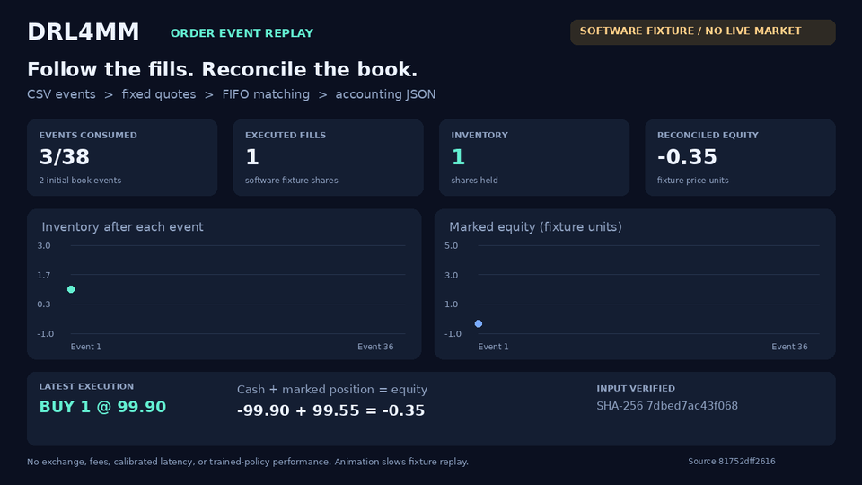

# Replay visualization

This is a rendered visualization of the **real `simulator.replay` CLI output**,
not a screen recording of an interactive dashboard. Each displayed value comes
from one exported simulator state; animation time is slowed down for readability.

The bundled CSV is a deliberately small **synthetic software fixture**, not
historical market data. It exercises order matching and accounting. The chart
is not trading-performance evidence. No live exchange, fees, calibrated latency,
or trained policy is represented. This fixture is the same kind of explicit
software fixture used by the repository's accounting and replay regression tests.



[Download the 1280 x 720 H.264 MP4](replay-demo.mp4)

## Reproduce

From the repository root, using Python 3.12, ffmpeg and DejaVu Sans system fonts:

```sh
python -m pip install numpy pandas gym==0.26.2 python-dotenv Pillow pytest
python -m pytest tests/test_accounting.py tests/test_historical_replay.py tests/test_lob_validation.py -q
python demos/render_demo.py --output-dir /tmp/drl-replay-demo
```

On Debian/Ubuntu, `apt-get install ffmpeg fonts-dejavu-core` supplies the renderer
prerequisites. The generator executes the real CLI, requires full consumption,
checks both accounting identities for every row, and creates JSON, GIF, MP4 and
a still preview. The source manifest checks Git blob identities before rendering,
so source changes cannot silently retain the old source attribution. Refresh the
manifest and the source label only after revalidating changed source.

## Verified capture

- Simulator source: `81752dff261636ec96c940de82b22bfeff731fcb`.
- Exact fetched source files were verified against their Git blob SHA-1 values.
- Targeted accounting/replay/input-integrity regression command above: 41 passed.
- Real CLI: 38 of 38 events consumed, 36 steps, 36 fills, complete true.
- Final inventory: 0. Final fixture cash/equity: 3.60, up to floating-point rounding.
- Output JSON contains the fixture SHA-256 and all per-event accounting values.
- MP4 verified as H.264, yuv420p, 1280 x 720, 15 seconds; GIF 960 x 540.
- First, middle, and last rendered states inspected for legibility and fidelity.

The simulator source is unchanged by this demo PR. Optional training, live
integrations, and the unfinished legacy synthetic initializer remain outside
this capture's verification scope.
